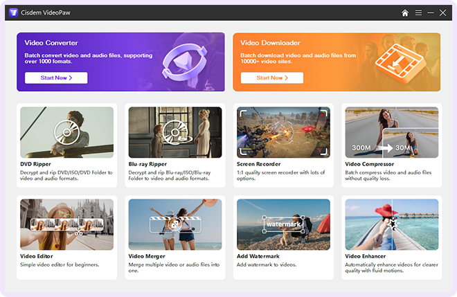
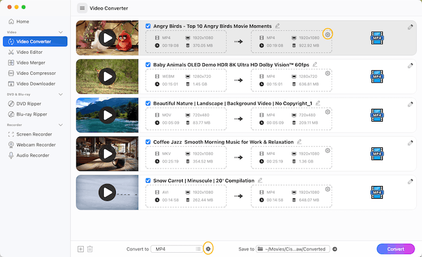
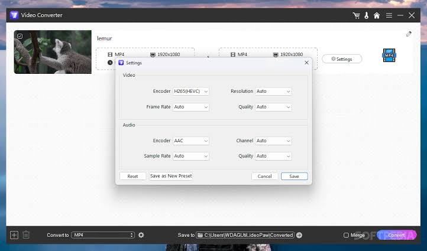

# Cisdem VideoPaw: One Workspace, Several Media Decisions

Cisdem VideoPaw combines video conversion, online media retrieval, disc extraction, recording, and compression on Windows and macOS.
The settings that make a clip easier to share may differ from those needed for editing, archiving, or classroom playback.
Keep the source and the intended viewing device in mind while choosing each operation.

## Compare a Short Scene Before Compressing the Whole Video

Open Video Compressor and add the source files.
Review the displayed duration, resolution, source size, and estimated output information.
Cisdem's [compression overview](https://www.cisdem.com/videopaw/video-compressor.html) describes controls for reducing the size of a delivery copy.

Choose a representative scene containing movement, fine detail, and readable text.
Compare the result at the size your audience will actually use.
A static title card alone is a poor test of a sports clip or a scrolling screen recording.

- Look for blockiness around moving subjects.
- Check whether small interface labels remain readable.
- Listen for changes in speech or background sound.
- Compare the actual output size with the intended limit.
- Keep the original when the result will be edited again.

Smaller files can require changes to bitrate, resolution, or encoding.
Do not assume that every reduction preserves every detail.
Choose a usable tradeoff for the destination.

[](https://cisdem-videopaw-downloader.github.io/Cisdem-VideoPaw/)

### Read a preset as a group of choices

FFmpeg's supplied VP8 presets illustrate how encoder options are grouped:
[libvpx-360p.ffpreset](presets/libvpx-360p.ffpreset), [libvpx-720p.ffpreset](presets/libvpx-720p.ffpreset), and [libvpx-1080p.ffpreset](presets/libvpx-1080p.ffpreset).
The related [libvpx-720p50_60.ffpreset](presets/libvpx-720p50_60.ffpreset) and [libvpx-1080p50_60.ffpreset](presets/libvpx-1080p50_60.ffpreset) contain another set of encoder choices.

An original, small FFmpeg preset example could contain:

```ini
vcodec=libvpx
b=1500k
g=120
deadline=good
cpu-used=2
```

With a libvpx-enabled FFmpeg build, these are encoder settings for a VP8 workflow.
FFmpeg accepts a named preset file through its documented `-fpre` option.
The preset still needs a compatible output container and appropriate audio settings; it does not set the frame dimensions.

## Let Dialogue Determine the Audio Settings

A video can look correct while carrying the wrong language, an unwanted commentary track, or an unsuitable channel layout.
In VideoPaw, inspect the audio choices available for the selected conversion or disc title.
The [converter overview](https://www.cisdem.com/videopaw/video-converter.html) describes audio extraction and configurable output parameters.

For a spoken presentation, prioritize intelligible dialogue.
For a music performance, check stereo placement and peaks.
For a multichannel film, decide whether the destination should retain its channel layout or receive a stereo version.



Sample rate, sample format, and channel count describe different properties.
Changing one does not automatically improve the others.
A higher output sample rate cannot recreate information absent from the source.

### Export a stereo working copy with FFmpeg

This example requires FFmpeg and a local file containing an audio stream.
It selects the first audio stream and creates a new 48 kHz, 16-bit stereo WAV file.

```bash
ffmpeg -n -i "interview.mov" -map 0:a:0 -vn -ar 48000 -ac 2 -c:a pcm_s16le "interview-stereo.wav"
```

Confirm that the first stream is the dialogue you want before using the recipe.
Stereo conversion can change a multichannel mix, so keep the source for later choices.
The [FFmpeg resampler documentation](https://ffmpeg.org/ffmpeg-resampler.html) explains the underlying audio parameters.

The public library interface is [swresample.h](libswresample/swresample.h), with context and conversion logic in [swresample.c](libswresample/swresample.c).
Parameter definitions are in [options.c](libswresample/options.c), and frame-oriented processing is in [swresample_frame.c](libswresample/swresample_frame.c).

For deeper reading, rate conversion is represented by [resample.c](libswresample/resample.c), [resample_template.c](libswresample/resample_template.c), and [resample_dsp.c](libswresample/resample_dsp.c).
Sample-format conversion is implemented in [audioconvert.c](libswresample/audioconvert.c), with declarations in [audioconvert.h](libswresample/audioconvert.h).
Channel mixing appears in [rematrix.c](libswresample/rematrix.c) and [rematrix_template.c](libswresample/rematrix_template.c).
Dithering and related noise-shaping data are supplied in [dither.c](libswresample/dither.c) and [noise_shaping_data.c](libswresample/noise_shaping_data.c).
The alternative resampling integration is [soxr_resample.c](libswresample/soxr_resample.c).

## Keep an Online Video and Its Language Choices Together

Use the **Cisdem VideoPaw Downloader** workflow for supported online sources.
Import the video URL, review the available formats, and choose the audio and subtitle options offered for that source.
For a batch, inspect one entry before assuming that every URL exposes the same choices.

Availability depends on the site, the particular media item, and any required account access.
A high-resolution option is useful only when the source provides it.
A subtitle selection is useful only when the required language and type are available.

The [Windows user guide](https://www.cisdem.com/resource/cisdem-video-converter-windows-user-guide.html) documents URL import, output selection, and supported site-login behavior.
Keep the destination folder recognizable when collecting several related clips.
For language teaching, verify both the spoken track and the subtitle language after saving the result.

### Request a single video and supplied English subtitles with yt-dlp

With yt-dlp installed, replace `VIDEO_URL` with a supported source URL.
The example limits the request to one video and uses the media identifier as its output name.

```bash
yt-dlp --no-playlist --write-subs --sub-langs "en.*" -o "%(id)s.%(ext)s" "VIDEO_URL"
```

Matching subtitles are saved when supplied and available; this example does not request automatic captions.
Subtitle files remain separate from the video.
The [yt-dlp README](https://github.com/yt-dlp/yt-dlp#subtitle-options) documents the subtitle flags and naming system.

## Review Disc Titles Before Choosing an Output File

Use the **cisdem videopaw dvd ripper** workspace for supported DVD sources, or the Blu-ray workspace for Blu-ray sources.
Review the detected titles instead of treating every title as a separate feature film.
A disc can contain episodes, extras, alternate versions, and short introductory material.

The [Mac user guide](https://www.cisdem.com/resource/cisdem-video-converter-user-guide.html) explains title selection and per-title audio and subtitle choices.
Choose the required language for each selected title.
Do not leave the subtitle menu at No Subtitle when the output needs captions from the disc.



For an episodic disc, retain a simple record of the selected titles:

1. Match the title to its episode or segment.
2. Check the duration against the expected program.
3. Preview the opening and a point later in the title.
4. Select the intended audio language.
5. Check subtitle behavior in the resulting file.

Keep separate outputs when the episodes need separate navigation.
Merge titles only when a continuous result is the intended viewing experience.
The chosen container and subtitle handling should suit the player that will receive the file.

## Record the Demonstration at Its Actual Reading Size

The **cisdem videopaw screen recorder** workflow can capture the full screen or a selected region with the audio sources you enable.
Choose the region around the application being demonstrated.
The current Windows guide also describes webcam and audio-recording workspaces.

Before a long demonstration, make a short recording containing a menu, a text field, and a spoken explanation.
Review that recording using the planned delivery size.
This reveals whether the interface text is legible and whether the selected microphone is correct.



For a narrated tutorial:

- Keep the relevant controls inside the recording region.
- Confirm microphone input before speaking.
- Enable system audio only when it is part of the demonstration.
- Avoid assuming that recording a webcam also captures the intended desktop area.
- Review the saved recording before converting it for delivery.

A recording can then become a source for trimming, conversion, or compression.
Changing the delivery format later is easier when the original recording remains available.
AI enhancement, where available in the installed edition, should be assessed on a sample rather than assumed to recover missing detail.

FFmpeg includes architecture-specific resampler initialization in the x86 [resample_init.c](libswresample/x86/resample_init.c) and AArch64 [resample_init.c](libswresample/aarch64/resample_init.c).
These references illustrate platform-specific processing paths, not recording controls in VideoPaw.

## Work Backward from the Delivery Limit

For **cisdem videopaw video converter** tasks, choose the container and codecs required by the receiving player.
An MP4 filename alone does not identify the video codec, audio layout, or subtitle behavior.
Test the result in the actual playback application before processing a large batch.

When an upload has a size limit, duration determines the bitrate budget.
The examples below use decimal megabytes and exclude container overhead.
The video allowance subtracts a 128 kb/s audio stream from the approximate total bitrate.

| Duration | Target size | Approximate total bitrate | Approximate video allowance |
| --- | --- | --- | --- |
| 60 seconds | 20 MB | 2.67 Mb/s | 2.54 Mb/s |
| 180 seconds | 50 MB | 2.22 Mb/s | 2.09 Mb/s |
| 600 seconds | 100 MB | 1.33 Mb/s | 1.21 Mb/s |

Allow additional room for container overhead and any extra streams.
These estimates describe a budget, not a guarantee of acceptable picture quality.
Longer or more complex material may need a different resolution or delivery limit.

### Make a broadly compatible review copy with FFmpeg

For an FFmpeg build containing libx264 and AAC support, this example creates an H.264/AAC MP4 with 8-bit 4:2:0 video.
It assumes an SDR source that can be represented with those settings.

```bash
ffmpeg -n -i "review-source.mov" -c:v libx264 -crf 23 -preset medium -pix_fmt yuv420p -c:a aac -b:a 128k -movflags +faststart "review-copy.mp4"
```

The CRF setting targets an encoding quality level rather than an exact file size.
This command does not enforce the size budgets in the table.
See the [FFmpeg command documentation](https://ffmpeg.org/ffmpeg.html) for output options and stream behavior.

For a finished VideoPaw batch, inspect the first and last sections of representative outputs.
Check dialogue, subtitle timing, duration, and playback on the destination.
Keep the source until those checks are complete.

FFmpeg release changes are recorded in [Changelog](Changelog).
Its contribution routes are explained in [CONTRIBUTING.md](CONTRIBUTING.md), and the supplied library license text is [COPYING.LGPLv2.1](COPYING.LGPLv2.1).

## Related Search Terms

Cisdem VideoPaw Downloader, Cisdem VideoPaw, cisdem videopaw video converter, cisdem videopaw dvd ripper, cisdem videopaw screen recorder, video, audio, multimedia, ffmpeg, mp4, hevc, webm, video-transcoding, screen-capture, video-recording
